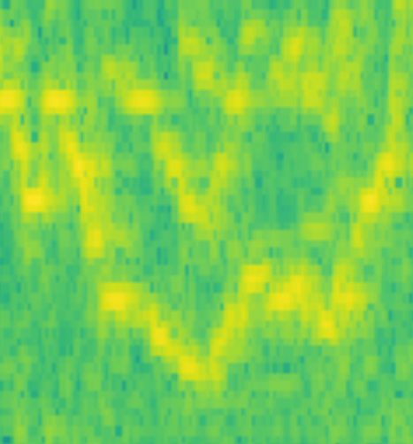

# audio-painter



This started as a tool for learning music by ear. Then I plotted a spectrogram of Charlie Parker warming up and kept staring at it, so now it's turning into something that paints music instead.

So far it's a short-time Fourier transform in Python with [NumPy](https://numpy.org/) and [SciPy](https://scipy.org/), and a script that plots the result.

I wrote about it here: [Getting Lost in Bird's Lines](https://goncalo-soares.com/blog/seeing-bird/).

## Running

Requires [uv](https://docs.astral.sh/uv/) and an audio file.

```sh
uv run scripts/plot_spectrogram.py path/to/clip.wav

uv run pytest
```

## What's next

Some kind of visualizer: you give it a recording and watch a painting being made in real time. I don't know yet what it looks like.
